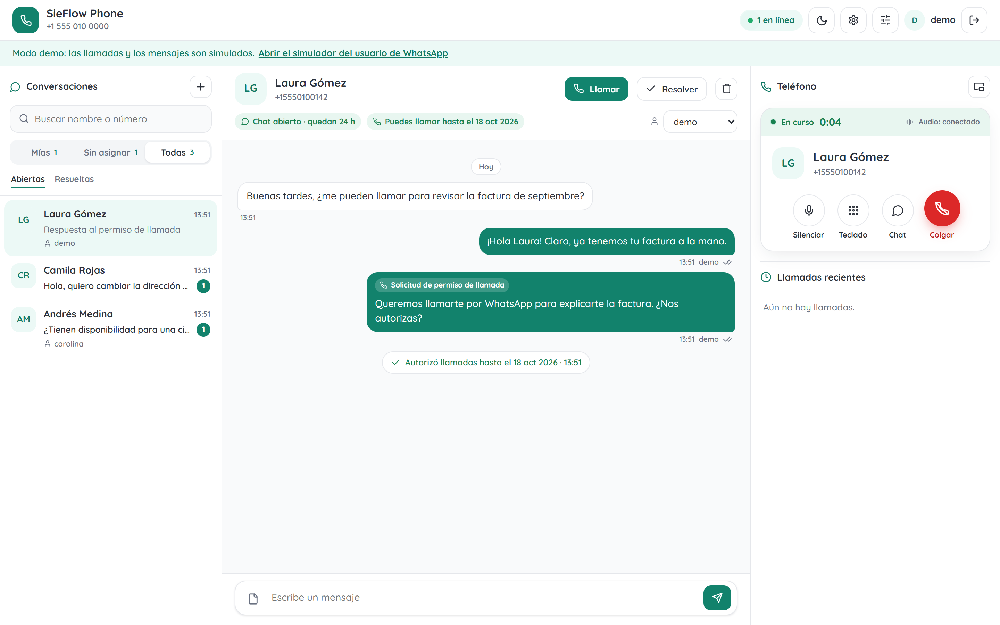
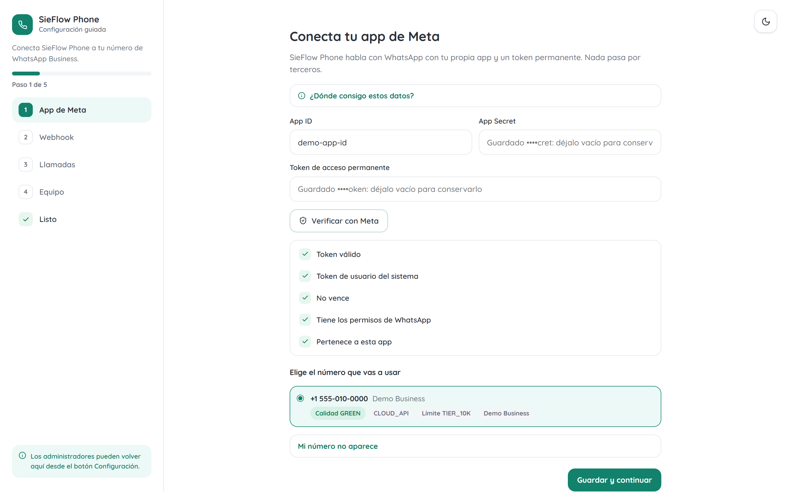
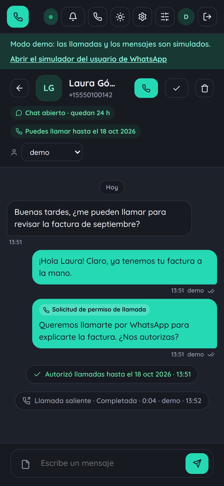

# SieFlow Phone

**Self-hosted WhatsApp calls and chat for your team.** Answer and place WhatsApp voice calls from the browser and reply to WhatsApp messages from a shared inbox. No Asterisk, no SIP trunk, no media server: one small container with zero dependencies.

[](https://github.com/IntegraLaIA/sieflow-phone/actions/workflows/ci.yml)
[](https://github.com/IntegraLaIA/sieflow-phone/releases)
[](LICENSE)

Part of [SieFlow](https://sieflow.ai), by INTEGRALAIA. · [Español](README.es.md)



## Features

- **Phone in the browser.** Incoming WhatsApp calls ring on every signed-in operator and the first one to answer takes it. Outgoing calls with the call permission WhatsApp requires. Mute, keypad tones, microphone and speaker selection.
- **Floating phone.** Pop the phone out of the browser into an always-on-top window, like a mini player (Chrome and Edge).
- **Shared inbox.** Messages and calls in one thread per customer: text, photos, voice notes, documents, locations. Replies inside the 24-hour window, approved templates outside it, delivery ticks.
- **Call permission from the chat.** An interactive request inside the 24-hour window, a template with the permission button outside it, and the answer shows up in the thread.
- **Multi-agent, without the complexity.** Mine / Unassigned / All, the first reply takes the conversation, assign to a teammate, resolve and reopen.
- **Guided setup.** An empty instance asks for everything in the browser and checks each value live against Meta, down to configuring the webhook for you.
- English and Spanish, light and dark, installable as a desktop app. A demo mode simulates WhatsApp so you can try everything without a Meta account.

## Try it in one minute

```bash
docker run --rm -p 8080:8080 -e DEMO_MODE=true ghcr.io/integralaia/sieflow-phone
```

Open http://localhost:8080 (user `demo`, password `demo1234`) and, in another tab, http://localhost:8080/simulator. The simulator plays the WhatsApp user: write to the business, call it, accept the call permission request. It runs the real, signed webhook flow against a mock of the WhatsApp API, and the audio is real WebRTC.

## Install on your server

You need Docker with Compose, a domain pointing to the server and ports 80/443 free.

```bash
mkdir sieflow-phone && cd sieflow-phone
curl -fsSLO https://raw.githubusercontent.com/IntegraLaIA/sieflow-phone/main/docker-compose.yml
curl -fsSLO https://raw.githubusercontent.com/IntegraLaIA/sieflow-phone/main/Caddyfile
echo "DOMAIN=phone.example.com" > .env
docker compose --profile https up -d
docker compose logs sieflow-phone | grep "Setup code"
```

Open `https://phone.example.com`, enter the setup code and follow the guided setup. Already running nginx, Traefik or another proxy? Start without the profile (`docker compose up -d`) and point the proxy at `127.0.0.1:8080`.

### Or let your AI assistant do it

Give Claude Code, Codex, Cursor or any agent with shell access this prompt:

> Install SieFlow Phone on this server following https://raw.githubusercontent.com/IntegraLaIA/sieflow-phone/main/INSTALL-WITH-AI.md

[INSTALL-WITH-AI.md](INSTALL-WITH-AI.md) walks the agent through checks, installation, verification, upgrades and backups, with rules on what to ask before doing.

## Guided setup



| Step | What it does |
| --- | --- |
| Your account | Creates the first administrator with the one-time code from the server logs, so nobody else can claim the instance. |
| Meta app | Checks App ID, App Secret and token live: valid, system user, never expires, permissions, same app. Then lists your WhatsApp accounts and numbers to pick one. |
| Webhook | Shows the callback URL and a generated verify token, and can configure the app webhook (`calls`, `messages`) and subscribe your account for you. Live checks show when Meta verifies the URL and when events arrive. |
| Calling | Checks Cloud API, quality, messaging limit, SIP off and restrictions; turns calling and the call button on; sets the call permission request text. |
| Team | Adds operators and administrators. |

What Meta requires: a number on the WhatsApp **Cloud API** (calling does not work on numbers shared with the WhatsApp Business app), a messaging limit of 2,000 or more for calling, and a Meta app with a permanent system user token (`whatsapp_business_messaging`, `whatsapp_business_management`).

## How it works

The WhatsApp Cloud API negotiates calls with standard WebRTC SDP and terminates the audio on Meta's media servers. A browser is a WebRTC endpoint, so it can talk to WhatsApp directly. SieFlow Phone relays the signaling and keeps the inbox:

```
 Operator's browser                     SieFlow Phone (Node)             WhatsApp Cloud API
 ------------------                     --------------------             ------------------
 RTCPeerConnection   <-- SSE events --  webhook /webhook  <-- calls, messages, statuses
 inbox UI            -- JSON POSTs -->  Graph API client  -- pre_accept/accept, messages -->
        |                                                                         |
        +===================== audio: WebRTC (Opus, DTLS-SRTP) ==================+
                         straight to Meta, never through SieFlow Phone
```

Incoming call: Meta sends a `connect` webhook with an SDP offer; the operator who answers creates the SDP answer in the browser; SieFlow Phone sends `pre_accept`, waits for the media connection, then `accept` with the same SDP. The microphone goes on the line only after `accept` returns 200, as Meta asks. Outgoing calls attach the microphone when the person picks up.



## Settings

Nothing is required in the environment: the guided setup stores everything. Any of these, when set, wins over the setup and shows there as read-only.

| Variable | Description |
| --- | --- |
| `WA_APP_ID`, `WA_APP_SECRET` | Meta app; the secret verifies webhook signatures |
| `WA_ACCESS_TOKEN` | Permanent Graph API token |
| `WA_WABA_ID`, `WA_PHONE_NUMBER_ID` | WhatsApp Business Account and phone number |
| `WA_VERIFY_TOKEN` | Webhook verification token (generated if missing) |
| `WA_DISPLAY_NUMBER`, `WA_GRAPH_VERSION` | Number in the header; Graph API version (default `v24.0`) |
| `PERMISSION_REQUEST_TEXT` | Text of the call permission request |
| `PUBLIC_URL` | Public address, used to suggest the webhook URL |
| `SETUP_CODE` | Fixed setup code (8+ letters or digits) instead of a random one |
| `USERS` / `USERS_FILE` | Administrators as `name:scrypt-hash` (`node src/cli.js hash-password`) |
| `SESSION_SECRET`, `SESSION_TTL_HOURS` | Session key (otherwise generated and stored) and length (default 12 h) |
| `RETENTION_DAYS` | Delete messages and call records older than this many days |
| `ICE_SERVERS`, `TURN_URLS`, `TURN_SECRET` | Extra STUN/TURN; with `TURN_SECRET`, short-lived per-operator TURN credentials |
| `WEBHOOK_FORWARD_URL` | Forward every webhook, signature included, to another backend |
| `SIEFLOW_PHONE_VERSION` | Image tag used by the compose file (default `latest`) |
| `DEMO_MODE` | Mock WhatsApp API and simulator; data in memory only. Never on a public server |

**Already receiving WhatsApp messages elsewhere?** Meta allows one webhook URL per app. Point it at SieFlow Phone and set `WEBHOOK_FORWARD_URL` to your existing endpoint: every webhook is forwarded untouched, with Meta's signature.

**Strict firewalls.** WhatsApp media servers have public addresses, so most networks connect directly. For operators on networks that block UDP, `docker compose --profile turn up -d` adds coturn (set `TURN_SECRET` and `TURN_URLS`; see [INSTALL-WITH-AI.md](INSTALL-WITH-AI.md#optional-turn-for-strict-networks)).

<br clear="right">

## Privacy and security

- **Your data stays on your server**: settings, operators, conversations and call records live in one SQLite file in the data volume. Call audio never reaches the server.
- **Retention and erasure**: `RETENTION_DAYS` deletes old messages automatically, and administrators can delete a contact with all its messages and calls.
- **Hardened by default**: signed webhooks only, one-time setup code, scrypt passwords, sessions that end when a password changes, rate-limited sign-in, strict CSP, HSTS, and a container that runs unprivileged on a read-only filesystem.
- The only third-party request from the browser is the Quicksand font from Google Fonts.

Read [SECURITY.md](SECURITY.md) for the details and how to report a vulnerability.

## Limits

- Audio calls only, one call per operator at a time. Operators reply with text and templates; sending files is not built yet.
- No call transfer, recording or server-side transcription: the audio never reaches the server, which is what keeps it light.
- One instance and one WhatsApp number per instance.

## Development

```bash
npm run demo      # http://localhost:8080 and /simulator, no Meta account needed
npm test          # node:test, no dependencies
```

See [CONTRIBUTING.md](CONTRIBUTING.md). AI coding agents: read [AGENTS.md](AGENTS.md).

## Credits and license

Icons from [Lucide](https://lucide.dev) (ISC). Typeface [Quicksand](https://fonts.google.com/specimen/Quicksand) (OFL).

[MIT](LICENSE) © 2026 INTEGRALAIA SAS. WhatsApp is a trademark of Meta Platforms, Inc. SieFlow Phone is an independent project and is not affiliated with or endorsed by Meta.
